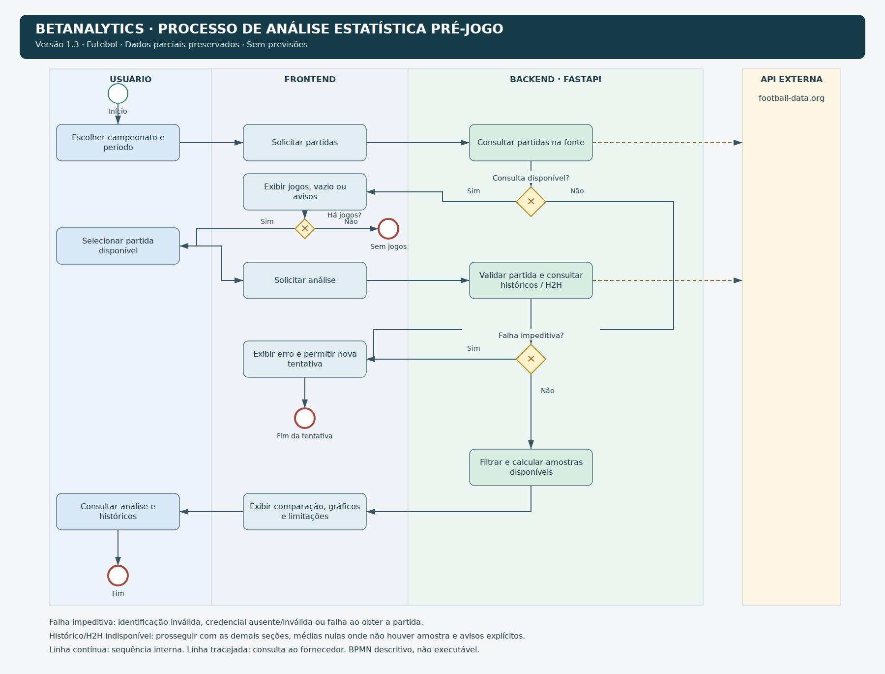

# Fluxo de análise — versão 1.3

O diagrama antigo foi substituído por uma representação coerente com a implementação.

- BPMN.png: imagem para apresentação.
- BPMN.svg: versão vetorial.
- BPMN.bpmn: XML BPMN 2.0 com informações de diagrama, editável em ferramentas compatíveis.

Pré-condição: usuário autorizado quando a proteção de acesso estiver habilitada. O diagrama descreve o fluxo de análise; o processo é descritivo, não executável.

A busca informa ausência de jogos sem solicitar análise. Erro impeditivo da fonte ou da identificação interrompe a tentativa; falta de histórico de equipe ou H2H preserva os dados disponíveis e produz avisos. Os indicadores são calculados somente sobre os jogos válidos.

